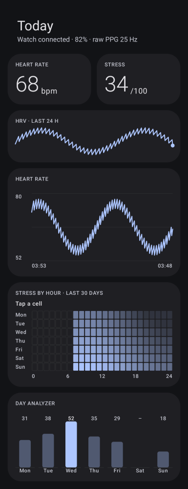

# Research Companion — TicWatch Pro 3

A two-part research analytics system built from `briefticwatch.txt` (v1.0):

* **Watch app** (`:wear`) is a sensor terminal for the TicWatch Pro 3 GPS (Wear OS 2.x, API 28). It samples PPG/heart rate, the accelerometer, the gyroscope and the step counter in a foreground service. It buffers the samples in a 24 h rolling Room database and ships compressed batches to the phone.
* **Phone app** (`:mobile`) is the analytics hub. It receives and stores every raw sample, then computes HR, HRV (RMSSD/SDNN/pNN50), stress, activity and weekday patterns. It also keeps a searchable diary and runs the reminders engine. The UI is Jetpack Compose with Material 3, dark-first and using dynamic colour.
* **Shared** (`:shared`) is plain Kotlin/JVM with no Android dependencies. It holds the wire protocol and the whole signal-processing pipeline, and it is unit-tested on synthetic PPG.



## Get the APKs

Every push to `main` runs **Actions › Build APKs**, which uploads `research-companion-watch.apk` and `research-companion-phone.apk` as an artifact. Pushing a `v*` tag also attaches both APKs to a GitHub Release.

Local build (JDK 17+, Android SDK 35):

```bash
./gradlew test assembleRelease
# wear/build/outputs/apk/release/wear-release.apk
# mobile/build/outputs/apk/release/mobile-release.apk
```

### Install (no cable needed)

```bash
# Watch: Settings › Developer options › ADB debugging + Debug over Wi-Fi
adb connect <watch-ip>:5555
adb -s <watch-ip>:5555 install -r research-companion-watch.apk
# Phone
adb install -r research-companion-phone.apk
```

### ⚠️ Both APKs must be signed with the same key

The Wearable Data Layer only connects apps that have the **same applicationId** (`com.disp06.researchcompanion`) **and the same signing certificate**. Both APKs from one CI run always match. To keep the key stable across runs, so you can update without uninstalling, create a keystore once and add it as repository secrets:

```bash
keytool -genkeypair -v -keystore rc.jks -alias rc -keyalg RSA -keysize 2048 -validity 10000
base64 -w0 rc.jks   # → secret RC_KEYSTORE_B64
```

Then add the secrets `RC_KEYSTORE_PASSWORD`, `RC_KEY_ALIAS` (`rc`) and `RC_KEY_PASSWORD`. Never commit the `.jks` file; `.gitignore` already excludes it.

## First run

1. Open the watch app → **Start** → allow *Body sensors*.
2. Watch app → **Battery settings** → exclude Research Companion from battery optimisation (brief §4.3; the permission is deliberately not declared).
3. Open the phone app. Onboarding (3 screens) confirms the watch is found and asks for notification permission.
4. Phone → Settings → **Heart signal source** loads the watch's full sensor list (see below).

## The big unknown: raw PPG on the TicWatch Pro 3

Android has **no public raw-PPG sensor type**. `Sensor.TYPE_HEART_RATE` delivers ~1 Hz BPM values, not beat-to-beat intervals, so **HRV cannot be computed from it**. The watch app therefore:

* **Auto mode:** looks for a vendor-private sensor (type ≥ 65536) whose name or `stringType` contains "ppg". If one exists, it records the raw waveform (1–4 channels) at 25/50 Hz, and the phone computes real HRV.
* **Fallback:** if none is found, it records `TYPE_HEART_RATE`. Heart rate, activity and a weaker *HR-elevation* stress estimate still work, and the dashboard explains why HRV is missing.
* **Manual pick:** Settings › Heart signal source lists every sensor the watch reports, so you can pick a candidate by hand.

The brief suggests `TYPE_LIGHT` as a fallback. It is **not used**, because the ambient light sensor is not a PPG sensor.

Whether Mobvoi exposes raw PPG on firmware 2.26 can only be found out on the device. That is the first thing to check (Phase 1).

## Phase 1 checklist (brief §8)

The watch screen and Settings › About show everything you need:

| Check | Where |
|---|---|
| Which heart source is active (raw PPG vs HR) | watch status line / *Source* |
| Gaps > 30 s with the screen off (target: none over 8 h) | *Gaps > 30 s* |
| Whether the CPU wake lock had to be held | *CPU lock*: `not needed (wake-up FIFO)` or `held (no wake-up sensor)` |
| Battery drain | compare % over a day in Standard / Low power / Eco |

**About the wake lock:** non-wake-up sensors stop delivering once the CPU suspends with the screen off, and their FIFO overflows. The service prefers wake-up sensor variants with hardware FIFO batching of up to 10 s. When the core sensors have no wake-up variant, it holds a partial wake lock instead, which is reliable but costs more battery. The status line tells you which case your watch is in.

## Architecture

```
watch  SensorCollectorService ──(RAM buffers, flush on :00/:05/:10 …)──► Room rolling buffer (24 h)
         │  adaptive PPG 25↔50 Hz on motion, MOTION flag stream, eco duty-cycle via AlarmManager
         └─ UploadWorker ── DataClient /batch/{key}/{seq} (≤ 50 KB chunks, CRC32) ──►
phone  PhoneListenerService ─ reassemble from Data Layer → verify → store raw → ACK → delete items
         └─ Processing: merge overlapping batches → resample → 0.5–4 Hz zero-phase band-pass
            → motion gating (accel std, 2 s blocks) → SSF peak detection + parabolic refinement
            → IBI 300–2000 ms + ectopic filter → RMSSD/SDNN/pNN50 per 5-min window
            → stress vs. 7-day sleep baseline → activity class → hourly diary → threshold rules
```

* **No data loss:** the watch keeps a batch until the phone acks it, and re-sends it if no ack arrives within 45 min. The phone dedupes by batch key.
* **Payload:** about 75 KB per 5 minutes at 50 Hz PPG + 50 Hz accelerometer. Timestamps are delta-varint encoded, IMU values are quantised to delta int16 (0.01 m/s² / 0.001 rad/s), PPG is lossless float32, and everything is DEFLATE-compressed.
* **Reminders:** *time* and *interval* rules are pushed to the watch and fire there through AlarmManager, so they work while the phone is away. *Threshold* rules (`stress>70 for 10m`, `hr>110 for 5m`, `rmssd<20 for 15m`) are evaluated on the phone after each batch and every 15 min, with a 60 min cooldown. Snooze and Done on the watch report back to the phone, and Done is logged in the diary.
* **Commands:** start/stop and similar commands that can't reach the watch are queued in Room and retried with WorkManager exponential backoff. The queue also flushes as soon as the watch capability becomes reachable again.

## Validation status

| | Result |
|---|---|
| Synthetic PPG, 25 Hz / 50 Hz / inverted polarity | RMSSD error 0.2–0.6 % (`SharedTests`) |
| Weak alternate beats (was: half heart rate) | fixed: polarity × threshold candidates checked against watch HR / autocorrelation |
| Noisy PPG (30 % noise, ±6 ms jitter) | 13–17 % with template-matched beat timing |
| FIFO-clumped sensor timestamps | repaired, 0.7 % |
| Motion gating | beats rejected, HRV withheld during vigorous motion |
| Real wrist data vs. ECG | **not yet done.** Needs a chest strap (e.g. Polar H10) recording in parallel |

Synthetic signals are much cleaner than real wrist PPG. Expect real-world error to be dominated by motion and contact quality. The brief gives two targets (<15 % in §2, <5 % in §11); only an ECG comparison can show which one this pipeline actually reaches.

## Deviations from the brief

* **Watch storage:** the watch DB stores one compressed `payload` BLOB per batch instead of separate ppg/accel/gyro BLOBs. This avoids re-encoding on upload.
* **Transfer:** chunked DataItems only, with no socket fallback. Batches stay around 75 KB per 5 min after compression.
* **Charts:** drawn with Compose Canvas instead of MPAndroidChart/Vico. This keeps the phone APK at about 3 MB and gives touch-to-inspect readouts.
* **Stress formula:** the appendix heuristic `100·(1 − RMSSD/baseline)` is 0 whenever HRV is at or above baseline, which is most of the time. It is replaced by a personal log-ratio score, `30 − 60·log2(RMSSD/resting RMSSD)`, plus up to `40·(HR − resting HR)/resting HR`. Your usual resting state is ≈ 30, HRV at 70 % of usual ≈ 60, and half your usual HRV ≈ 90. The baseline is the 7-day median RMSSD of calm windows: "learning" after 15 min, "personal" after 3 h. Stress is suppressed during moderate/vigorous activity because physical load ≠ stress.
* **LF/HF:** frequency-domain HRV is not implemented.
* **SDK levels:** phone `minSdk 28`, `targetSdk 34`. Watch `targetSdk 30`, the highest the TicWatch Pro 3 can run (Wear OS 3.5).

Research tool, not a medical device.
